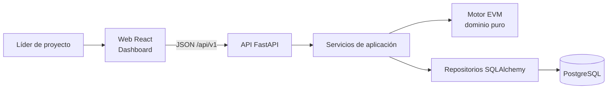
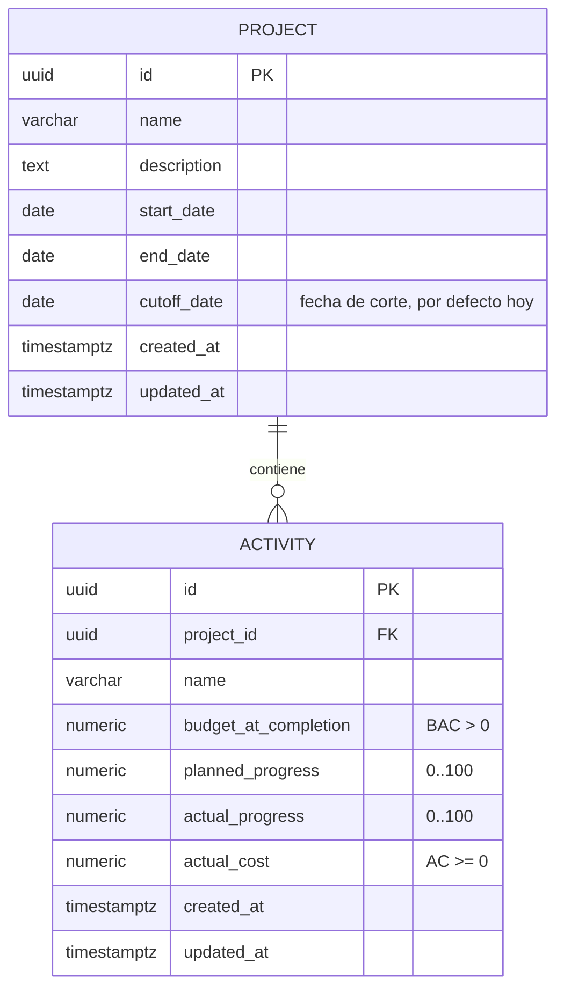
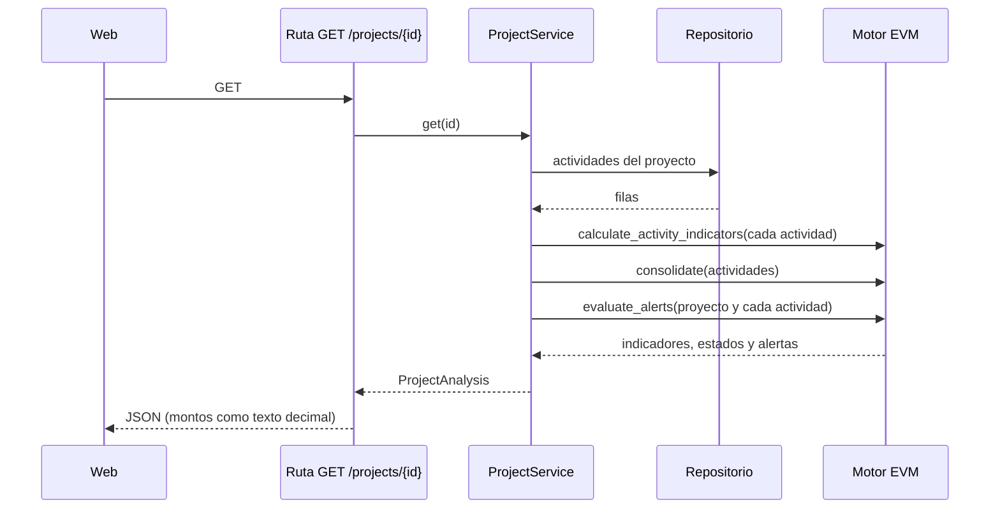

# Arquitectura

## Vista general



## Capas del backend

```
backend/app/
├── domain/          # Reglas EVM. Python puro: sin FastAPI, sin SQLAlchemy.
│   ├── evm.py       #   calculate_activity_indicators(), consolidate()
│   ├── status.py    #   estados, interpretación y banda de tolerancia
│   └── alerts.py    #   evaluate_alerts(): reglas fijas sobre los indicadores
├── application/     # Casos de uso: orquesta repositorios + dominio.
│   └── services.py  #   ProjectService, ActivityService, analyze_project()
├── infrastructure/  # SQLAlchemy, sesión, repositorios.
└── api/             # Rutas, esquemas Pydantic, manejo de errores.
    └── v1/
```

Regla de dependencias: `api → application → domain` y `application → infrastructure`. El dominio no importa nada de las otras capas, por eso lo pruebo sin servidor ni base de datos.

**Por qué no usé una arquitectura hexagonal completa, con puertos e interfaces:** con dos entidades y una sola base de datos, una interfaz de repositorio por entidad duplica código sin un beneficio que se pueda mostrar. El límite que sí importa es el del dominio EVM, y ese se mantiene.

## Modelo de datos



- Los indicadores **no se guardan**: se calculan al leer. Son derivados de 4 campos, y guardarlos permitiría que quedaran desactualizados.
- `ON DELETE CASCADE` de proyecto a actividades. La interfaz pide confirmación antes de borrar.
- Montos en `NUMERIC(18,2)` y porcentajes en `NUMERIC(5,2)`, con `CHECK` en la base de datos además de la validación de Pydantic.

## Flujo de un cálculo



## API

| Método | Ruta | Respuesta |
|--------|------|-----------|
| POST | `/api/v1/projects` | 201 Proyecto |
| GET | `/api/v1/projects` | 200 Lista paginada con los indicadores consolidados de cada proyecto |
| GET | `/api/v1/projects/{id}` | 200 Proyecto + consolidado + actividades con indicadores + alertas · 404 |
| PUT | `/api/v1/projects/{id}` | 200 · 404 · 422 |
| DELETE | `/api/v1/projects/{id}` | 204 · 404 |
| POST | `/api/v1/projects/{id}/activities` | 201 · 404 · 422 |
| GET | `/api/v1/projects/{id}/activities` | 200 · 404 |
| GET | `/api/v1/activities/{id}` | 200 · 404 |
| PUT | `/api/v1/activities/{id}` | 200 · 404 · 422 |
| DELETE | `/api/v1/activities/{id}` | 204 · 404 |
| GET | `/health` | 200 |

Todos los errores usan el mismo formato: `{"error": {"code": "PROJECT_NOT_FOUND", "message": "...", "details": [...]}}`.
